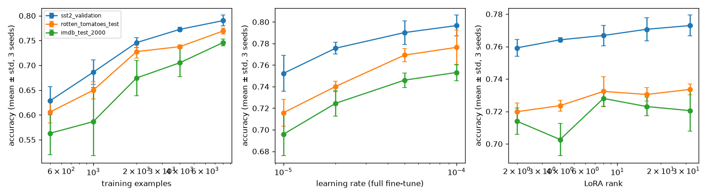
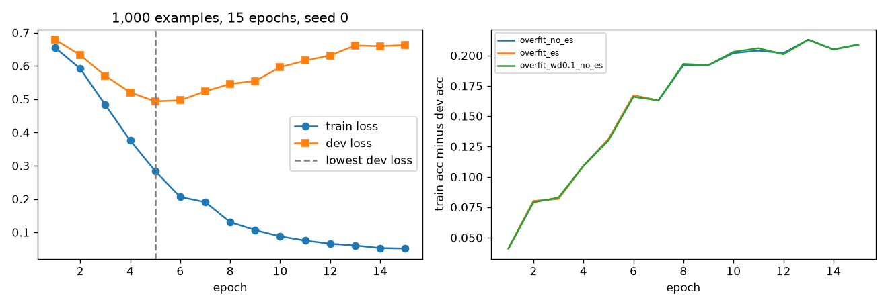
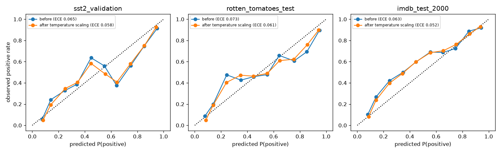
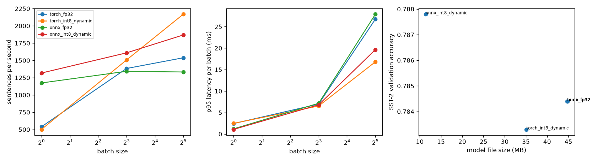

# Small Model Fine-Tune

Fine-tuning, evaluation and CPU inference benchmarks for **BERT-Mini** (`google/bert_uncased_L-4_H-256_A-4`, 4 layers, hidden size 256, 11.2M parameters) on **SST-2** binary sentiment. It covers full fine-tuning, LoRA and a frozen encoder, ablations over 3 seeds, three test sets, a reproduction of a published result, calibration, significance tests against a TF-IDF baseline, and fp32 versus int8 inference in PyTorch and ONNX Runtime.

Every number below comes from runs on one CPU only Linux machine (8 vCPU Intel Xeon, 16 GB RAM, no GPU) between 24 November 2026 15:20 and 17:10 London time. Result files are committed next to the code, and each section links to them.

See also the [model card](MODEL_CARD.md).

## Contents

- [Fine-tuning evidence](#fine-tuning-evidence)
- [Research depth: expanded evaluation, reproduction and ablations](#research-depth-expanded-evaluation-reproduction-and-ablations)
- [Inference optimisation: latency, throughput, memory and quantisation](#inference-optimisation-latency-throughput-memory-and-quantisation)
- [Experiment tracking](#experiment-tracking)
- [Reproduce](#reproduce)

## Fine-tuning evidence

### Model, data and configuration

| | |
| --- | --- |
| Base model | `google/bert_uncased_L-4_H-256_A-4` (11,171,074 parameters) |
| Task | SST-2 sentence sentiment, positive or negative |
| Training data | 8,000 sentences sampled from the SST-2 train split (data seed 13) |
| Dev data | 1,000 other SST-2 train sentences, used for early stopping and checkpoint choice |
| Test data | SST-2 validation (872), Rotten Tomatoes test (1,066), IMDB test sample (2,000, seed 0) |
| Optimiser | AdamW, learning rate 5e-05, weight decay 0.01, linear schedule with 6% warmup, gradient clipping at 1.0 |
| Batch, length, epochs | batch 32, max 64 tokens for training (128 for evaluation), 3 epochs |
| Checkpoint | best dev loss, evaluated twice per epoch |
| Determinism | `torch.use_deterministic_algorithms(True)`, fixed seeds, 2 CPU threads |

Configs: [configs/base.yaml](configs/base.yaml) and [configs/reproduce_turc2019.yaml](configs/reproduce_turc2019.yaml). Each run writes its config, learning curve, metrics and predictions to `results/<run>/`.

### Results

| Run | Train rows | Trainable params | SST-2 val acc | SST-2 val F1 | SST-2 val ROC AUC | Rotten Tomatoes acc | IMDB acc |
| --- | --- | --- | --- | --- | --- | --- | --- |
| Base config, seed 0 ([metrics](results/main/metrics.json)) | 8,000 | 11,171,074 | 0.784 | 0.784 | 0.879 | 0.764 | 0.744 |
| Full SST-2 train, 4 epochs, lr 1e-4 ([metrics](results/reproduce_turc2019/metrics.json)) | 66,349 | 11,171,074 | 0.862 | 0.863 | 0.929 | 0.875 | 0.760 |

Confusion matrices on SST-2 validation (rows true negative/positive, columns predicted): base run [[343, 85], [103, 341]], full data run [[373, 55], [65, 379]]. The full data run trained for 51 minutes on 2 threads; the best dev loss came after epoch 3 of 4.

### Method comparison (3 seeds each, mean ± std accuracy)

| Method | Learning rate | Trainable params | SST-2 val | Rotten Tomatoes | IMDB |
| --- | --- | --- | --- | --- | --- |
| Full fine-tune | 5e-5 | 11,171,074 | 0.790 ± 0.011 | 0.769 ± 0.006 | 0.746 ± 0.007 |
| LoRA r=8 on query and value | 5e-4 | 33,282 | 0.767 ± 0.006 | 0.732 ± 0.009 | 0.728 ± 0.005 |
| Frozen encoder, train the classifier only | 1e-3 | 514 | 0.672 ± 0.005 | 0.633 ± 0.003 | 0.619 ± 0.006 |

LoRA r=8 trains 0.3% of the parameters and gives up about 2 points against full fine-tuning on SST-2 validation. Freezing the encoder loses about 12 points.

## Research depth: expanded evaluation, reproduction and ablations

### Expanded evaluation sets and a contamination check

Besides in-domain SST-2 validation, every run is scored on Rotten Tomatoes (short movie review snippets) and 2,000 IMDB reviews (long, different style). A text overlap check ([results/overlap_with_sst2_train.json](results/overlap_with_sst2_train.json)) found that **457 of 1066 Rotten Tomatoes test sentences (43%) appear word for word in SST-2 train**, because SST was built from the same review snippets. SST-2 validation has 2 overlaps and IMDB none. On the full data model, Rotten Tomatoes accuracy is 0.930 on the overlapping rows and 0.834 on the 609 clean rows, so the headline Rotten Tomatoes number is inflated and the clean figure is the one to quote.

### Reproductions

- **Same seed, run twice.** The base config was trained twice from scratch. Accuracy matched on all three test sets and the largest difference in any predicted probability was 0.0, so training is bit for bit repeatable on this machine ([results/repro_main](results/repro_main)).

- **Published result.** Turc et al. (2019), *Well-Read Students Learn Better*, report **85.9** accuracy for BERT-Mini on the GLUE SST-2 test set (picking batch size and learning rate from a grid, 4 epochs). Test labels are not public, so the same model was trained on the full SST-2 train split (less 1,000 dev rows) with one setting from their grid (batch 32, lr 1e-4, 4 epochs) and scored on SST-2 validation: **86.2** (95% bootstrap CI 83.8 to 88.5). That is in line with the paper, although validation and test are different sets.

### Baseline and significance tests

A TF-IDF (1 and 2 grams) plus logistic regression baseline was trained on exactly the same rows, with C chosen on the dev split. Paired bootstrap for the accuracy difference and an exact McNemar test on the same examples ([results/evaluation_report.json](results/evaluation_report.json), [results/full_data_vs_tfidf.json](results/full_data_vs_tfidf.json)):

| Training rows | Test set | BERT-Mini acc | TF-IDF acc | Difference, 95% CI | McNemar p |
| --- | --- | --- | --- | --- | --- |
| 8,000 | sst2_validation | 0.784 | 0.795 | -0.039 to +0.018 | 0.55 |
| 8,000 | rotten_tomatoes_test | 0.764 | 0.791 | -0.054 to +0.001 | 0.06 |
| 8,000 | imdb_test_2000 | 0.744 | 0.745 | -0.021 to +0.019 | 0.96 |
| 66,349 | sst2_validation | 0.862 | 0.825 | +0.010 to +0.065 | 0.006 |
| 66,349 | rotten_tomatoes_test | 0.875 | 0.874 | -0.016 to +0.016 | 1.000 |
| 66,349 | imdb_test_2000 | 0.760 | 0.793 | -0.053 to -0.013 | 0.001 |

With 8,000 rows, BERT-Mini is not distinguishable from TF-IDF on any test set. With the full train split it is significantly better in domain (+3.8 points on SST-2 validation, p = 0.006), tied on Rotten Tomatoes, and significantly **worse** on IMDB (-3.3 points, p = 0.001), where reviews are long and get cut at 128 tokens while TF-IDF reads the whole review.

### Ablations (3 seeds each)



| Ablation | Setting | SST-2 val | Rotten Tomatoes | IMDB |
| --- | --- | --- | --- | --- |
| Training rows | 500 | 0.628 ± 0.028 | 0.606 ± 0.022 | 0.563 ± 0.043 |
| Training rows | 1,000 | 0.686 ± 0.025 | 0.650 ± 0.017 | 0.587 ± 0.069 |
| Training rows | 2,000 | 0.746 ± 0.010 | 0.728 ± 0.013 | 0.674 ± 0.036 |
| Training rows | 4,000 | 0.773 ± 0.004 | 0.738 ± 0.004 | 0.705 ± 0.028 |
| Training rows | 8,000 | 0.790 ± 0.011 | 0.769 ± 0.006 | 0.746 ± 0.007 |
| Learning rate (full) | 1e-5 | 0.752 ± 0.017 | 0.716 ± 0.012 | 0.696 ± 0.020 |
| Learning rate (full) | 2e-5 | 0.776 ± 0.005 | 0.740 ± 0.005 | 0.724 ± 0.012 |
| Learning rate (full) | 5e-5 | 0.790 ± 0.011 | 0.769 ± 0.006 | 0.746 ± 0.007 |
| Learning rate (full) | 1e-4 | 0.797 ± 0.010 | 0.776 ± 0.016 | 0.753 ± 0.008 |
| LoRA rank | 2 | 0.759 ± 0.005 | 0.720 ± 0.005 | 0.714 ± 0.008 |
| LoRA rank | 4 | 0.764 ± 0.001 | 0.724 ± 0.003 | 0.703 ± 0.010 |
| LoRA rank | 8 | 0.767 ± 0.006 | 0.732 ± 0.009 | 0.728 ± 0.005 |
| LoRA rank | 16 | 0.771 ± 0.007 | 0.730 ± 0.004 | 0.723 ± 0.006 |
| LoRA rank | 32 | 0.773 ± 0.006 | 0.734 ± 0.003 | 0.720 ± 0.013 |

Full table with F1, ROC AUC, ECE and parameter counts: [results/ablation_summary.csv](results/ablation_summary.csv). What they show: accuracy keeps rising with data up to 8,000 rows and the seed spread mostly shrinks; 1e-4 was the best of the learning rates tried and 1e-5 underfits in 3 epochs; LoRA gains about 1.4 points from rank 2 to rank 32 on SST-2 and the out of domain sets barely move. Wall clock training times in the CSV were measured while other jobs shared the CPU, so they are not a fair speed comparison.

### Overfitting and early stopping



1,000 training rows for 15 epochs, 3 seeds. Without early stopping the train minus dev accuracy gap reached 0.22 and dev loss bottomed out around epoch 5 then climbed. Early stopping (patience 2, restoring the best checkpoint) stopped after 7.3 epochs on average, kept the same SST-2 accuracy (0.739 ± 0.015 against 0.745 ± 0.010) and cut calibration error (ECE) from 0.184 to 0.078. Raising weight decay from 0.01 to 0.1 made no measurable difference.

### Calibration



One temperature (T = 1.07) fitted on the dev split lowered ECE on every test set: SST-2 0.065 to 0.058, Rotten Tomatoes 0.073 to 0.061, IMDB 0.063 to 0.052. Accuracy is unchanged by design.

### Error analysis (base model)

| Test set | Shortest quarter | Longest quarter | With a negation word | Without |
| --- | --- | --- | --- | --- |
| sst2_validation | 0.833 | 0.720 | 0.665 (n=182) | 0.816 |
| rotten_tomatoes_test | 0.815 | 0.753 | 0.704 (n=152) | 0.774 |
| imdb_test_2000 | 0.811 | 0.681 | 0.738 (n=1544) | 0.763 |

Longer inputs and sentences with negation (not, never, n't and similar) are the weak spots.

## Inference optimisation: latency, throughput, memory and quantisation

The base model ([results/main](results/main)) was benchmarked in four forms, each in its own process, on SST-2 validation with dynamic padding (max 128 tokens), 4 threads, 10 warm-up batches, 300 single sentence requests and every full batch of 8 and 32. **There is no GPU on this machine, so memory is process RAM (peak RSS), not VRAM.** CPU: Intel(R) Xeon(R) Processor. Run while the machine was otherwise idle. Raw results: [benchmark.json](results/inference/benchmark.json), [benchmark.csv](results/inference/benchmark.csv).



| Variant | File size (MB) | RAM to load (MB) | Peak RAM over baseline (MB) | p50 / p95 ms, batch 1 | Sentences/s, batch 1 | Sentences/s, batch 32 | SST-2 acc | Agreement with fp32 |
| --- | --- | --- | --- | --- | --- | --- | --- | --- |
| torch_fp32 | 44.7 | 164 | 255 | 1.80 / 2.44 | 540 | 1538 | 0.7844 | 100.0% |
| torch_int8_dynamic | 35.1 | 176 | 246 | 1.96 / 2.49 | 502 | 2168 | 0.7833 | 96.9% |
| onnx_fp32 | 44.8 | 86 | 191 | 0.84 / 1.21 | 1174 | 1333 | 0.7844 | 100.0% |
| onnx_int8_dynamic | 11.4 | 47 | 139 | 0.72 / 1.08 | 1318 | 1868 | 0.7878 | 98.7% |

Trade-offs:

- **ONNX Runtime int8** is the best all round option here: 3.9 times smaller on disk (11.4 MB against 44.7 MB), 3.5 times less RAM to load, 2.4 times the single request throughput of PyTorch fp32 (p50 0.72 ms against 1.80 ms) and 1.2 times the batch 32 throughput. Accuracy moved from 0.7844 to 0.7878, and 1.3% of predictions flipped.

- **PyTorch dynamic int8** helps only at larger batches (1.4 times the throughput at batch 32) and is slightly slower than fp32 for single requests. Its file only shrinks to 35.1 MB because the 7.8M parameter embedding table stays fp32. 3.1% of predictions flipped, with accuracy 0.7833.

- **ONNX fp32** matches PyTorch predictions exactly and halves single request latency, but is slower than PyTorch fp32 at batch 32 (1,333 against 1,538 sentences per second).

- All variants were measured once. Run to run timing noise on a shared virtual machine is a few percent, so small differences (for example ONNX fp32 against PyTorch fp32 at batch 8) are not meaningful.

## Experiment tracking

Training writes a full record per run (config, learning curve, metrics, predictions, hardware). `scripts/log_runs_to_mlflow.py` loads all 54 runs into MLflow (params, final metrics, the learning curve as step metrics, config and metrics as artifacts) and exports the run table to [results/mlflow_runs.csv](results/mlflow_runs.csv), so the tracking record is visible without a server. To browse it: `mlflow ui --backend-store-uri sqlite:////tmp/smft_mlflow.db` after running the script.

## Reproduce

```bash
python -m venv .venv && source .venv/bin/activate
pip install -r requirements.txt
export PYTHONPATH=src

python -m smft.train --config configs/base.yaml --out results/main --save-model     # about 3 minutes
python -m smft.train --config configs/reproduce_turc2019.yaml --out results/reproduce_turc2019   # about 50 minutes
python scripts/ablation_plan.py | xargs -P 3 -I{} sh -c "{}"                       # 51 runs
python -m smft.aggregate                       # tables, plots, calibration, significance
python scripts/compare_full_data.py            # full data run against TF-IDF
python scripts/check_overlap.py                # contamination check
python -m smft.bench --model results/main/model --out results/inference --threads 4
python scripts/plot_benchmark.py
python scripts/log_runs_to_mlflow.py           # MLflow tracking and results/mlflow_runs.csv
pytest tests
```

Exact package versions are pinned in [requirements.txt](requirements.txt). Model weights are not committed; `--save-model` recreates them.

## Project structure

```text
configs/            training configs (YAML)
src/smft/data.py    dataset loading and fixed splits
src/smft/train.py   training loop: full, LoRA, frozen; early stopping; evaluation
src/smft/metrics.py accuracy, F1, ROC AUC, Brier, ECE, bootstrap, McNemar
src/smft/baseline.py TF-IDF baseline
src/smft/aggregate.py ablation tables, plots, calibration, significance, error slices
src/smft/bench.py   inference benchmark (PyTorch and ONNX Runtime, fp32 and int8)
scripts/            ablation grid, comparisons, contamination check, MLflow export
results/            every run's config, metrics and predictions, plus summary files
tests/              unit tests for the metrics
```

## Limitations

- CPU only. No GPU, so no VRAM figures and no fp16 or GPU quantisation results.
- Ablations use an 8,000 sentence subset and 3 seeds to stay within CPU time. The 16,000 row size step, a 2e-4 learning rate and a zero weight decay run were planned but dropped for time.
- The published comparison uses SST-2 validation, not the hidden GLUE test set.
- There is no CI workflow yet.

## Author

Tehilla Obanor. Portfolio: https://cv.omnitest.dev/
